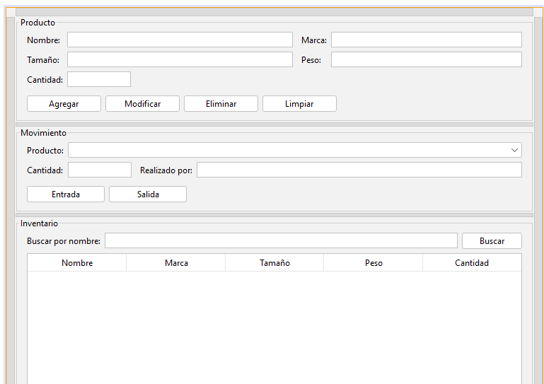
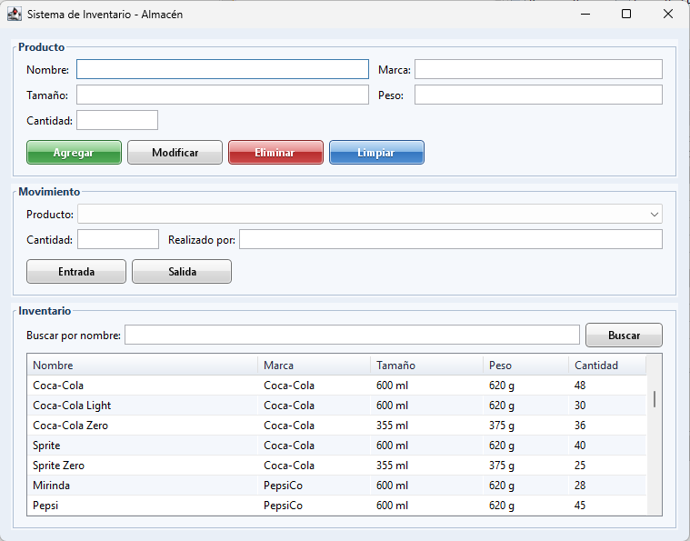
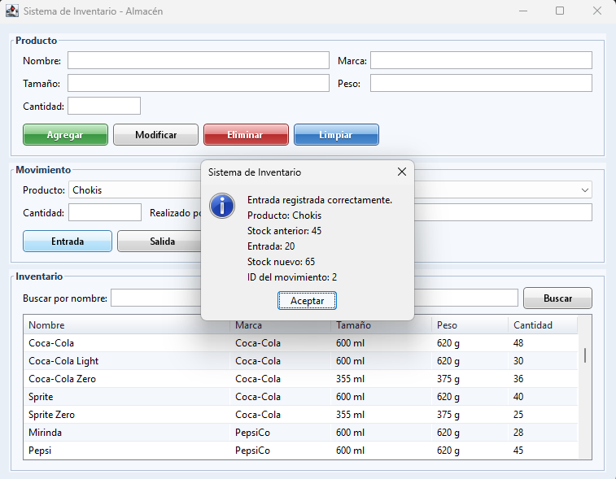
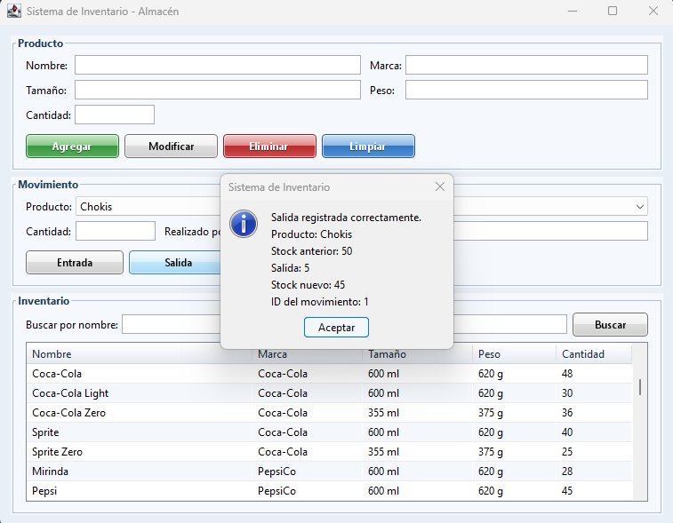

# Capturas de pantalla — AeroStock

Esta sección contiene capturas de diferentes partes del proyecto, incluyendo el diseño de la interfaz en NetBeans, la aplicación en ejecución y ejemplos de operaciones realizadas sobre el inventario.

---

## Diseño en NetBeans

Captura del formulario desde el editor visual de NetBeans, mostrando la distribución de los componentes de la interfaz antes de ejecutar la aplicación.

---

## Aplicación ejecutándose

Vista de la aplicación en ejecución, mostrando la interfaz con el estilo visual personalizado inspirado en Windows 7/Aero.

---

## Registro de una entrada

Ejemplo de una entrada registrada correctamente en el inventario. En la captura se agregan 20 unidades de Chokis, pasando el stock de 45 a 65 unidades.

---

## Registro de una salida

Ejemplo de una salida registrada correctamente. En la captura se retiran 5 unidades de Chokis, pasando el stock de 50 a 45 unidades.

